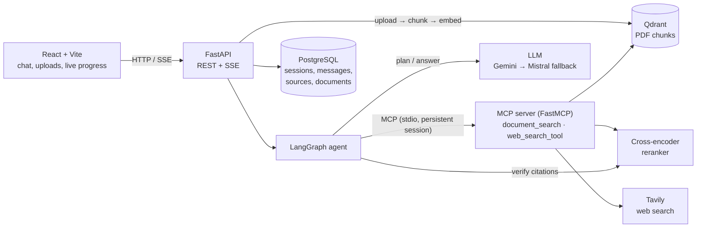
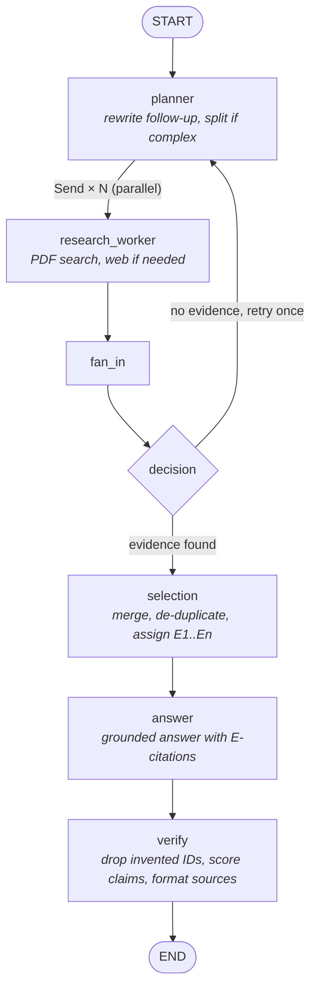

# ResearchFlow AI

A research agent that answers questions from **your PDFs and the web**, and backs every claim with a citation that is **checked** before you see it.

Ask a question, follow up in the same conversation, and watch the agent plan, search and write in real time. Each answer shows which PDF page or web page supports each claim, plus how many of those citations passed an automatic support check.

> **Stack:** LangGraph · LangChain · MCP (FastMCP) · Qdrant · cross-encoder reranking · Tavily · FastAPI (SSE streaming) · PostgreSQL · React + Vite · Docker · GitHub Actions

<!-- Add a screenshot or GIF of the app here: docs/demo.gif -->

---

## Features

- **Agentic research with LangGraph:** a planner rewrites follow-up questions and splits complex ones, research workers run **in parallel** (fan-out with `Send`), and the agent **retries with web search** when the first round finds nothing useful.
- **Hybrid evidence:** PDFs are searched first (Qdrant vector search + cross-encoder reranking). The web (Tavily) is used only when the PDFs aren't relevant enough or the question is about recent events.
- **Tools over MCP:** document search and web search are exposed by an **MCP server** (FastMCP, stdio). The API keeps **one long-lived MCP session**, so models load once instead of on every tool call.
- **Citation verification (no extra LLM call):** citations to evidence that doesn't exist are removed, and every cited claim is scored against its source with the reranker. The UI shows e.g. *"7/8 citations verified"*.
- **Conversation memory:** follow-up questions in a session use the recent history (stored in PostgreSQL); the planner turns "When was *it* founded?" into a standalone search.
- **Scoped search:** tick PDFs in the sidebar to search only those documents (Qdrant metadata filter).
- **Live progress:** `POST /research/stream` streams the agent's steps (Server-Sent Events); the UI shows *Planning → Searching → Writing → Checking citations*.
- **Cost-aware LLM use:** 1 LLM call for a simple question, 2 for complex or follow-up ones, automatic Gemini → Mistral fallback, and an on-disk response cache.
- **Document management:** PDF upload with validation (type, size, magic bytes, duplicate detection by SHA-256), listing and deletion.
- **Production basics:** Docker images, `docker compose` for the full stack, optional API-key auth, CI with tests, lint and build.

---

## Architecture



### The agent graph



### What happens when you ask a question

1. **Session:** the API creates a session (or continues one) and loads the last few messages.
2. **Planner:** skipped for simple first questions (rule-based). Otherwise the LLM returns a structured `ResearchPlan` (Pydantic): a standalone question plus 1–2 sub-questions.
3. **Research workers (parallel):** each sub-question searches the PDFs over MCP: top 10 by vector similarity, reranked by a cross-encoder, best 3 kept. If the best score is low, or the question mentions recent events, the worker also searches the web.
4. **Decision:** if no evidence was found at all, one more round runs with web search.
5. **Answer:** evidence is numbered `E1…En` and the LLM writes an answer that cites those IDs.
6. **Verify:** unknown IDs are removed; each cited sentence is scored against its evidence by the cross-encoder; IDs become readable citations (`[Source: nike.pdf, Page: 4]` or web links).
7. **Save + stream:** progress events are streamed to the UI; the answer and its sources are saved to PostgreSQL.

---

## Design decisions

| Decision | Why | Trade-off |
|---|---|---|
| **Rule-based tool routing** (default) instead of asking the LLM which tool to use | Saves 1 LLM call per sub-question. The reranker score is a better signal for "are the PDFs good enough?" than an LLM guess (confidence-based / corrective RAG). | Less flexible for unusual questions. `ROUTING_MODE=llm` switches back to LLM tool calling. |
| **Persistent MCP session** | Spawning a new MCP server per tool call reloaded the embedding model and reranker every time, which made research take minutes. One session makes tool calls fast and supports concurrent calls. | The API must manage the server's lifecycle (started in the background on startup, restarted if it dies). |
| **Citation check with the cross-encoder** | Catches invented citations and claims their source doesn't support, without paying for a second LLM call. | Relevance ≠ entailment: a claim can be on-topic but still wrong. An LLM judge or NLI model would be stricter (see Roadmap). |
| **Structured planner output** (Pydantic) | No fragile text parsing; the planner also rewrites follow-ups into standalone questions. | Needs a model that supports tool calling / JSON schema. |
| **Rerank 10 → keep 3** | Vector search is fast but rough; the cross-encoder reads question and chunk together and ranks much better. | Extra CPU time per query (small model, ~22M parameters). |
| **LLM fallback + cache** | A free-tier quota running out shouldn't break the app; repeated prompts cost nothing. | Cached answers can be stale for "latest" questions (`LLM_CACHE=off`). |
| **SSE progress instead of WebSockets** | One-way server → client updates over plain HTTP; simple to proxy and deploy. | Token-by-token answer streaming is not implemented yet. |

---

## Evaluation

`eval/dataset.jsonl` has 16 questions about the sample PDFs in `data/` (Nike, Puma, Loro Piana Wikipedia articles), each with the page that answers it and the facts the answer must contain.

```bash
python -m eval.run_eval --ingest     # index data/*.pdf once
python -m eval.run_eval              # retrieval metrics (no LLM calls)
python -m eval.run_eval --answers    # + answer accuracy and citation support (1 LLM call per question)
```

It measures:

- **Retrieval:** Hit@1, Hit@3 and MRR (is the right page among the top results?)
- **Answers:** accuracy (expected facts present), citation support rate, invented citations removed, median latency

The report is written to `eval/results/report.md`.

<!-- After running the evaluation, paste the summary table here, e.g.
| Metric | Score |
|---|---|
| Hit@3 | …% |
| Answer accuracy | …% |
| Citation support rate | …% |
-->

---

## Quick start

### Option A: Docker (whole stack)

```bash
cp .env.example .env        # add GOOGLE_API_KEY or MISTRAL_API_KEY, TAVILY_API_KEY, POSTGRES_PASSWORD
docker compose up --build
```

Open http://localhost:5173. API docs are at http://localhost:8000/docs, and the Qdrant dashboard at http://localhost:6333/dashboard.

> If you already run Qdrant or Postgres locally on the same ports, stop them first.

### Option B: local development

Requirements: Python 3.12+, Node 22+, PostgreSQL, Qdrant (`docker run -p 6333:6333 qdrant/qdrant`).

```bash
# Backend
python -m venv .venv
.venv\Scripts\activate          # Windows  (macOS/Linux: source .venv/bin/activate)
pip install -r requirements.txt
cp .env.example .env            # fill in your keys
uvicorn backend.main:app --reload

# Frontend (second terminal)
cd frontend
npm install
npm run dev
```

Database tables are created automatically on startup (`backend/schema.sql`).

---

## Configuration

All settings live in `.env` (see `.env.example`). The most useful ones:

| Variable | Default | What it does |
|---|---|---|
| `LLM_PROVIDER` | `gemini` | Main model (`gemini` or `mistral`); the other is the fallback |
| `ROUTING_MODE` | `rules` | `rules` (cheap) or `llm` (LLM tool calling) |
| `PLANNER_MODE` | `auto` | When to split questions: `auto`, `always`, `never` |
| `DOC_RELEVANCE_THRESHOLD` | `0` | Below this reranker score, PDFs are "weak" and web search runs |
| `CITATION_SUPPORT_THRESHOLD` | `0` | Reranker score a cited claim needs to count as supported |
| `LLM_CACHE` | `on` | Cache identical LLM requests on disk |
| `API_KEY` | *(empty)* | If set, every request needs `X-API-Key` |
| `CORS_ORIGINS` | `http://localhost:5173,…` | Allowed frontend origins |

---

## API

| Method | Path | Description |
|---|---|---|
| `POST` | `/research` | Run research and return the answer (`question`, optional `session_id`, `document_ids`) |
| `POST` | `/research/stream` | Same, streamed as Server-Sent Events: `session` → `step`… → `result` |
| `GET` | `/sessions` | List research sessions |
| `GET` | `/sessions/{id}/messages` | Messages of a session with their sources |
| `PATCH` / `DELETE` | `/sessions/{id}` | Rename / delete a session |
| `POST` | `/documents/upload` | Upload and index a PDF (max 20 MB) |
| `GET` | `/documents` | List uploaded PDFs |
| `DELETE` | `/documents/{id}` | Delete a PDF and its chunks |
| `GET` | `/health` | Health check |

Interactive docs: `/docs`.

---

## Project structure

```
backend/
  main.py            FastAPI app: REST + SSE endpoints, uploads, auth, CORS
  agent/
    graph.py         LangGraph agent (planner, parallel workers, verify)
    routing.py       rule-based planning and tool routing
    service.py       runs the graph, streams progress, saves answers
  rag/
    pipeline.py      retrieval + reranking, web search, answer, citation check
    ingestion.py     PDF → chunks → Qdrant
    vectorstore.py   embedding model + Qdrant client
  mcp/
    server.py        MCP tools (document_search, web_search_tool)
    client.py        persistent MCP client session
  llm.py             model setup, fallback, cache, structured output
  db.py, schema.sql  PostgreSQL access and schema
prompts/research.py  planner and answer prompts
frontend/src/
  App.jsx            state and data flow
  components/        Sidebar, Composer, Message, ProgressSteps
  Markdown.jsx       safe Markdown + citation rendering
  SourceList.jsx     sources under each answer
eval/                dataset, metrics, evaluation runner
tests/               pytest suite (models, Qdrant, web and LLM replaced by fakes)
```

---

## Testing

```bash
pip install -r requirements-test.txt
pytest
```

The suite covers the API (uploads, sessions, streaming, auth), the agent graph end-to-end with fake tools, routing rules, citation verification, the MCP client (one server process for concurrent calls) and the evaluation metrics. CI runs the tests, ESLint and a production build on every push.

---

## Limitations and roadmap

- **Stronger claim checking:** replace the relevance check with an NLI model or LLM-as-judge for real entailment.
- **Token streaming** of the answer text (only progress steps are streamed today).
- **Multi-user:** accounts and per-user documents; today it is single-tenant with an optional shared API key.
- **Background jobs:** move research into a task queue so long requests survive restarts.
- **Tracing:** LangSmith can be enabled with its environment variables (`LANGSMITH_TRACING=true`, `LANGSMITH_API_KEY`).
- `langchain-community` (PDF loader, cache) is being sunset upstream; migrate to standalone packages.
